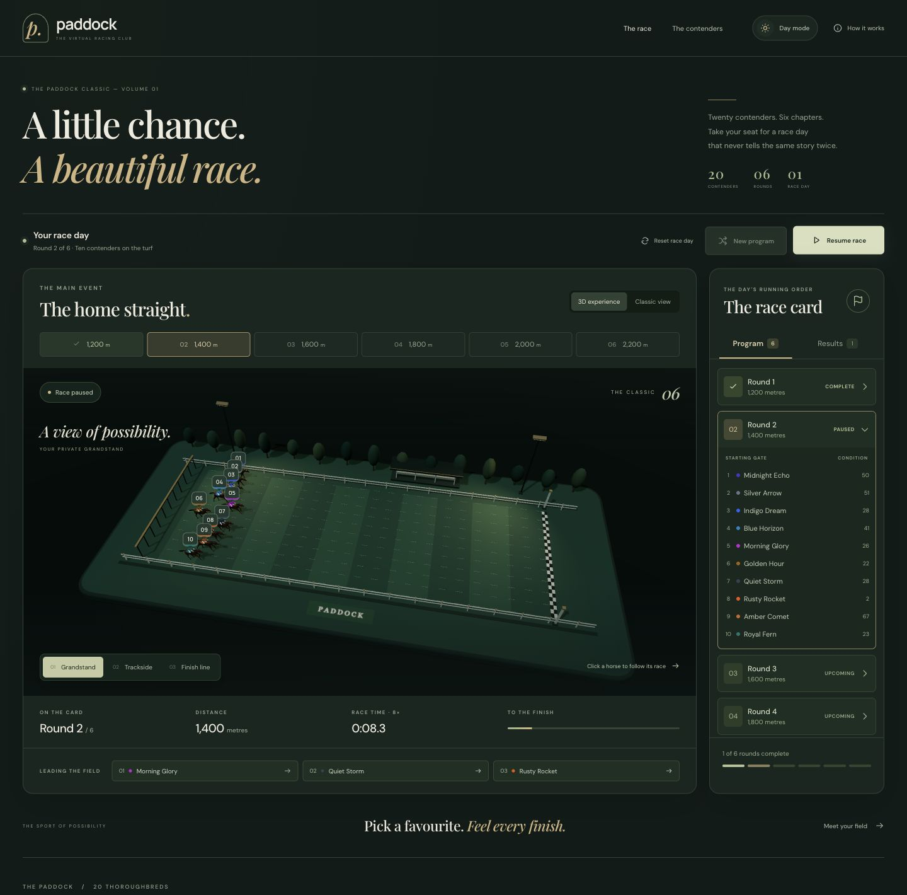

# Paddock

A six-round horse racing simulator built with Vue 3, TypeScript, Pinia, Vite and Three.js. Generate a race program, explore a miniature 3D racecourse, follow a contender, and inspect the complete results of every round. A Classic view presents the same race as a two-dimensional track.



## Stack

| Layer     | Technology                                         |
| --------- | -------------------------------------------------- |
| Interface | Vue 3.5, Composition API, custom CSS               |
| Language  | TypeScript 5.9                                     |
| State     | Pinia 3.0                                          |
| 3D scene  | Three.js 0.187, WebGL 2, local animated glTF model |
| Build     | Vite 7.3                                           |
| Tests     | Vitest 4.1, Playwright 1.62                        |

## Run locally

Requires Node.js 22.12+ (Node 24 LTS recommended) and npm.

```sh
npm ci
npm run dev
```

Open the local URL printed by Vite. No API keys, environment variables or backend are needed.

```sh
npm run build     # Type checking and production bundle
npm run preview   # Serve the production bundle
npm test          # Domain and state-transition tests
```

For browser tests:

```sh
npx playwright install chromium
npm run test:e2e
```

An existing Chrome installation can be used with `PLAYWRIGHT_CHANNEL=chrome npm run test:e2e`. The suite defines ten scenarios at desktop (1440 × 1000) and mobile (390 × 844) viewports, for 20 tests. It checks line-up validity, pause/resume, sequential results, resetting, keyboard navigation, horizontal overflow, contender filtering and selection, camera controls, theme persistence, and the opening's reload, Escape and reduced-motion behavior. It controls browser time rather than accessing the application store. Core racing scenarios use Classic view; the 3D-specific scenario explicitly skips when WebGL 2 is unavailable. `npm run test:e2e -- --list` lists the scenarios without launching a browser.

## Using the app

1. **Generate program** creates six rounds with ten randomly selected horses per round.
2. **Start racing** runs the rounds in sequence. The program follows the active round.
3. **Pause race / Resume race** freezes and continues the same race.
4. **Results** contains the full finishing order and simulated times for every completed round.
5. **Reset race day** clears progress and results after confirmation, retaining the existing line-up. **New program** draws a new line-up; it is disabled during running or paused races.
6. **Race again** repeats the existing program with fresh race-day performance samples.

Switching away from the browser tab pauses a running race. Opening the instructions or reset confirmation also pauses it; dismissing either leaves it paused until you resume. A page refresh creates a fresh session.

### Appearance and opening

- A 2.6-second cinematic opening plays on each page load and refresh. **Skip intro** and **Escape** reveal the page immediately; `prefers-reduced-motion` bypasses the opening without a fullscreen wait.
- The header's theme control switches between day and night. The initial theme follows the operating system until an explicit preference is selected; that choice is remembered across refreshes.
- Night mode updates the page palette and the 3D course's lights and materials without resetting the race, selected horse or camera. Only the theme preference is stored in `localStorage`; race programs, progress and results are not persisted.

### Explore the racecourse

- **Grandstand** shows the whole course, **Trackside** follows the selected horse (or the leader), and **Finish line** frames the finish. Drag the scene to adjust the viewing angle.
- Click a horse, its numbered label, or a leading-runner chip to select it and switch to the following camera. The same selection appears in the paddock profile.
- **Meet the contenders** shows all 20 horses. Filter to **This race**, sort by number, condition or name, and select a card to inspect that horse. **Follow on track** is available when the horse belongs to the current line-up.
- **Classic view** is available at any time and retains the race's time, progress and results. If the 3D scene cannot load or its graphics context becomes unavailable, the interface falls back to Classic view.

## Architecture

```text
src/
  domain/race.ts                 Pure generation and simulation functions
  domain/race.test.ts            Race-rule and simulation tests
  stores/race.ts                 Pinia state and allowed transitions
  stores/race.test.ts            Lifecycle and result-integrity tests
  composables/useRaceClock.ts    Browser animation frame lifecycle
  composables/useTheme.ts        System theme and persisted appearance preference
  scene/course.ts               Procedural course geometry and resource disposal
  scene/model.ts                Skinned-horse normalization
  scene/model.test.ts           Regression check against the bundled GLB
  components/
    OpeningSequence.vue         Skippable cinematic entrance and motion preference
    RaceExperience.vue          Presentation switch, camera controls and race telemetry
    RaceScene.vue               Lazy-loaded Three.js scene, model animation and selection
    FieldExplorer.vue           Contender profiles, filtering, sorting and selection
    RaceTrack.vue               Classic two-dimensional visualization and timing
    RaceProgram.vue             Schedule and completed results
    HorseSprite.vue             Local raster atlas and CSS gallop animation
    RacePodium.vue              Top three finishers in the final round
    AppIcon.vue                 Local icon primitives
  App.vue                       Page layout, controls and dialogs
  theme.css                     Day/night surfaces and component colours
  polish.css                    Page-reveal choreography and interaction details
```

The domain has no Vue or browser dependencies. Random sources can be injected into domain functions for reproducible tests. The store owns state transitions; components render state and dispatch actions. `useRaceClock` is the only loop that advances the simulation. The 3D scene has a separate rendering loop that reads the same store positions and derives horse animation from simulation time. Camera changes and decorative animation cannot change race outcomes.

`RaceExperience` loads `RaceScene` asynchronously, keeping the 3D code in a separate bundle. The scene builds its course from reusable geometry, loads a local animated horse model, and clones independent skeletons for the runners. Pointer raycasting and projected button labels support selection. Rendering resolution is capped at a device pixel ratio of 2 (1.5 on narrow screens); rendering stops when the scene is off-screen or the document is hidden. Idle and paused scenes render only after a relevant interaction, stopping again once the camera settles. On unmount, the scene removes listeners and observers, cancels its frame callback, and disposes graphics resources.

There is no race-state persistence, router or server because this is a single-session, single-screen simulation. `useTheme` stores only the explicit appearance preference under `paddock-theme` in `localStorage`. The opening is mounted on each page load rather than remembered as a completed session step; its timers and listeners are removed on unmount. Classic view and the contender profile use local raster artwork; icons are local SVG. `HorseSprite` animates the four equal cells of a transparent 2×2 atlas with discrete CSS background positions. The decorative gallop pauses with the race and becomes a still frame for reduced-motion preferences. Typography uses Google Fonts with system fallbacks; the application remains functional without font-network access.

The animated 3D horse is **Horse by Quaternius**, released under **CC0 1.0** and bundled locally. Source, licence and file details are in [3D artwork credits](docs/3d-assets.md). Raster artwork prompts, dimensions and provenance are documented in [Racing artwork](docs/asset-prompts.md).

## Requirements and decisions

- **20 horses:** one part of the brief says “between 1 to 20”, while the rules explicitly require a pool of 20 and ten runners drawn from it. The implementation follows the explicit rules: exactly 20 stable identities, each with a unique colour and a random integer condition from 1 to 100.
- **Six rounds:** 1200, 1400, 1600, 1800, 2000 and 2200 metres, in that order. A Fisher–Yates shuffle selects ten unique horses per round. Horses may participate in more than one round.
- **Sequential execution:** a new round starts after every horse in the previous round has finished. Results are appended once per round and retained through the whole race day.
- **Pause:** the reference shows a Start/Pause control, so both pause and resume are included.
- **Condition:** the brief does not prescribe a formula. Expected speed is `14 + condition × 0.06 + random × 5` metres/second. Higher condition improves expected performance but does not guarantee winning. This is a game model, not a claim about real horse physiology.
- **Time:** the simulation runs at 8× real time. Displayed race and result times are simulated seconds, not wall-clock seconds.
- **Consistent animation and results:** finish times and smooth pacing variations are sampled once when a race day starts. Animation derives from elapsed time; it does not roll new randomness per frame. This makes outcomes independent of frame rate and pause duration. Progress is monotonic, finishes exactly at 100%, and exact ties resolve by starting lane.
- **Presentation:** the reference's paddock, track, program and results remain available. The main course uses a 3D presentation with an equivalent Classic view; the interactive paddock sits below the race panels. Mobile stacks the panels and uses a two-column contender grid.
- **Accessibility:** controls have descriptive labels and visible keyboard focus, tabs support arrow/Home/End navigation, native dialogs support Escape and focus containment, and a live region announces state changes without narrating every animation frame. Horse labels and contender cards are keyboard-accessible buttons. The opening offers a keyboard-accessible skip control and Escape shortcut. Reduced-motion preferences bypass the opening and disable decorative galloping and smooth camera transitions. Lane numbers and names supplement horse colours; Classic view provides an alternative to the 3D scene.

## Verification

All 22 unit tests and the production build pass. The suite also checks the actual bundled horse model at idle and across gallop poses, preventing a regression where stale skeleton bounds made the horses almost invisible. The domain tests cover generation constraints, condition influence, monotonic progress, exact finish positions, tie ordering, pause/resume, stale-result prevention, sequential completion, large time steps and the leader after multiple horses finish. Type checking and the production build are also part of the available checks.

Playwright scenarios are supplied separately from the unit suite. In the development environment, the standalone Chrome process was blocked before test execution; this is not recorded as a passing E2E run. Test discovery succeeded for all 20 cases (ten scenarios across two viewports), including the appearance and opening additions. The updated browser suite has not been executed; discovery does not establish that those scenarios pass.

Earlier interactive checks of the Classic presentation verified all six rounds and 60 ordered result entries, pause/resume, resetting from the Results panel, keyboard tab navigation, and a 390 px mobile layout without horizontal overflow. The subsequent 3D presentation was also checked interactively: all six rounds completed, the final podium matched the results, camera presets and drag orbit worked, selecting a horse updated its profile and tracking camera, contender filtering and condition sorting worked, and switching between 3D and Classic retained paused race time. Desktop (1440 px) and mobile (390 px) layouts were inspected without horizontal overflow. These interactive checks remain separate from the unexecuted Playwright suite.

The appearance update was checked in the in-app browser: the opening replayed after refresh, both Skip intro and Escape restored interaction, and the saved dark preference survived reload. Changing themes retained the paused race time. Day and night scenes, the dark contender cards, help dialog and Classic presentation were inspected. Mobile layouts at 390 px and 320 px had no horizontal overflow. The final preview produced no browser warnings or errors. Reduced-motion behavior is covered by the supplied browser scenario and code review; that scenario has not been executed in the standalone suite.

## Scope

No betting, money, login, analytics or third-party race data. No recruiter correspondence or assessment document is included in the project. The implementation is intentionally limited to the requested simulation and supporting tests.
